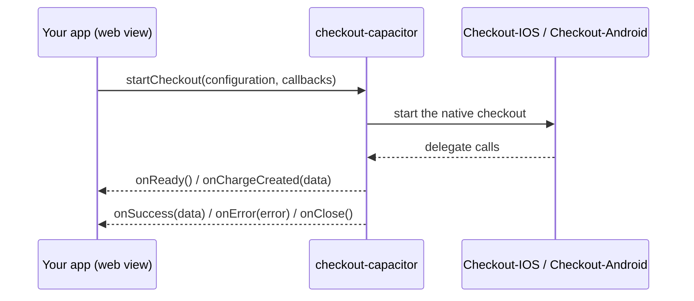

# checkout-capacitor

Tap Payments' Capacitor checkout SDK. Present a full Tap checkout from your Capacitor app, collect a card or local payment method, and get the result back through a few callbacks. It wraps the native [Checkout-IOS](https://github.com/Tap-Payments/Checkout-IOS) and [Checkout-Android](https://github.com/Tap-Payments/Checkout-Android) SDKs, with the same API as [checkout-react-native](https://github.com/Tap-Payments/Checkout-ReactNative).


- [Requirements](#requirements)
- [How it works](#how-it-works)
- [Installation](#installation)
- [Platform setup](#platform-setup)
- [Quick start](#quick-start)
- [Callbacks](#callbacks)
- [Configuration reference](#configuration-reference)
- [Charge vs Authorize](#charge-vs-authorize)
- [Sandbox vs production](#sandbox-vs-production)
- [Example app](#example-app)
- [Troubleshooting](#troubleshooting)
- [Plugin API](#plugin-api)

## Requirements

| | iOS | Android |
|---|---|---|
| Capacitor | 8 | 8 |
| Native SDK | `Checkout-IOS` 1.0.7 (Swift Package Manager or CocoaPods) | `com.github.Tap-Payments:Checkout-Android:1.0.9` (JitPack) |
| Minimum OS | iOS 15 | API 24 (Android 7.0) |
| Tooling | Xcode 16.3+ (the `Checkout-IOS` package uses `swift-tools-version` 6.1) | JDK 21 (Capacitor 8) |

The checkout is native only. On the web the plugin rejects with `unavailable`; use the Tap web SDK there.

## How it works



The callbacks are plugin events (`notifyListeners`): `startCheckout` adds a listener for each one and removes the previous checkout's listeners, so only the latest checkout's callbacks fire.

## Installation

```sh
npm install checkout-capacitor
npx cap sync
```

### iOS

Nothing to add. Capacitor 8 apps use Swift Package Manager by default, and `cap sync` adds the plugin, which depends on the `Checkout-IOS` package (exact version 1.0.7). Apps that still use CocoaPods get the `Checkout-IOS` pod through `CheckoutCapacitor.podspec`.

### Android

The native SDK is published on [JitPack](https://jitpack.io/#Tap-Payments/Checkout-Android). Add the repository to your app, in `android/build.gradle`:

```groovy
allprojects {
    repositories {
        google()
        mavenCentral()
        maven { url 'https://jitpack.io' }
    }
}
```

(or in `dependencyResolutionManagement` in `android/settings.gradle`, if your app declares its repositories there). To use another `Checkout-Android` version, set `checkoutAndroidVersion = '1.0.9'` in `android/variables.gradle`.

> [!NOTE]
> The Tap SDK's manifest sets `android:usesCleartextTraffic="true"`. If your app manifest sets that attribute too, add `tools:replace="android:usesCleartextTraffic"` on `<application>` or the manifest merge fails.

## Platform setup

### iOS: Info.plist

Add a camera usage description to `ios/App/App/Info.plist`. It is required by the card scanner; without it iOS terminates the app when the scanner opens.

```xml
<key>NSCameraUsageDescription</key>
<string>Used to scan your card.</string>
```

Apple Pay needs the *Apple Pay* capability and a merchant identifier on your app target.

### Android: permissions

The SDK's manifest already declares what it needs, and it is merged into your app's `AndroidManifest.xml` automatically:

| Permission | Used for |
|---|---|
| `INTERNET`, `ACCESS_WIFI_STATE` | Loading the checkout |
| `CAMERA` | The card scanner. The SDK asks for it at runtime when the scanner opens. |
| `NFC` | Reading a card with NFC (`cardOptions.alternativeCardInputs.cardNFC`) |

## Quick start

1. Build a configuration object.
2. Implement `CheckoutCallbacks`.
3. Call `startCheckout(configuration, callbacks)`.

```ts
import { startCheckout } from 'checkout-capacitor';
import type { CheckoutCallbacks } from 'checkout-capacitor';

const callbacks: CheckoutCallbacks = {
  onReady: () => {},
  onChargeCreated: (data) => console.log('charge created:', data),
  onSuccess: (data) => console.log('success:', data),
  onError: (error) => console.log('error:', error),
  onClose: () => {},
};

export function pay() {
  startCheckout(
    {
      gateway: { publicKey: 'pk_test_YOUR_PUBLIC_KEY' },
      language: 'en',
      themeMode: 'light',
      paymentType: 'ALL',
      supportedPaymentMethods: 'ALL',
      supportedCurrencies: 'ALL',
      selectedCurrency: 'KWD',
      amount: 5,
      customer: {
        firstName: 'Jane',
        lastName: 'Doe',
        email: 'jane@example.com',
        phone: { countryCode: '965', number: '55567890' },
      },
      order: {
        currency: 'KWD',
        amount: 5,
        items: [
          { name: 'Item', description: 'Item description',
            quantity: 1, amount: 5, currency: 'KWD' },
        ],
      },
      transaction: {
        mode: 'charge',
        charge: {
          saveCard: true,
          threeDSecure: true,
          redirect: { url: 'https://example.com/checkout/return' },
        },
      },
    },
    callbacks
  );
}
```

```ts
startCheckout(configuration: CheckoutConfiguration, callbacks: CheckoutCallbacks): Promise<void>
```

On iOS the checkout sheet is presented from the top-most view controller; on Android the plugin adds a full-screen checkout view over the activity's content (above the web view) and removes it when the flow ends. You do not add any view yourself.

Every outcome, including a checkout that cannot start, arrives in the callbacks: the returned promise resolves once the call went through and never rejects. If you call the plugin directly (`CheckoutCapacitor.startCheckout({ configurations })` and `addListener`), start-up errors reject that promise instead.

> [!NOTE]
> `startCheckout` does not validate the configuration. Invalid or missing values are reported by the Tap backend inside the checkout or through `onError`.

## Callbacks

`onReady`, `onSuccess`, `onError` and `onClose` are required; `onChargeCreated` is optional. `data` / `error` is a **JSON string** produced by the checkout; parse it with `JSON.parse`. `onReady`, `onSuccess`, `onError` and `onClose` fire at most once per `startCheckout` call. `onChargeCreated` fires for every charge the checkout creates, so it can fire more than once, for example when the customer comes back from KNET or another redirect and pays again. It keeps listening until the next `startCheckout` call: on Android, going back from KNET reports `onClose` and then shows the checkout again, where the customer can still pay.

| Callback | Fires when | Argument | Checkout dismissed | iOS (`CheckoutSDKDelegate`) | Android (`TapCheckoutStatusDelegate`) |
|---|---|---|---|---|---|
| `onReady()` | The checkout page finished loading and is ready for input. | none | No | `onReady()` | `onCheckoutReady()` |
| `onChargeCreated?(data)` | A charge/authorization object was created, before the checkout completes. | JSON string | No | `onChargeCreated(data:)` | `onCheckoutChargeCreated(data)` |
| `onSuccess(data)` | The checkout completed, including after a 3D Secure challenge. | JSON string (after 3DS: the charge id) | Yes | `onSuccess(data:)` | `onCheckoutSuccess(data)` |
| `onError(error)` | The checkout failed, a network step failed, or (iOS) the camera permission was denied. | JSON string (some native errors are plain text) | Yes | `onError(data:)` | `onCheckoutError(error)` |
| `onClose()` | The user closed the checkout. | none | Yes | `onClose()` | `onCheckoutcancel()` |

> [!TIP]
> Treat `onSuccess` as "the flow finished". After 3D Secure its payload is `{"chargeId":"chg_..."}`; confirm the final payment status on your server with the Retrieve Charge API ([Charges reference](https://developers.tap.company/reference/charges)) (`GET /v2/charges/{charge_id}`).

## Configuration reference

The configuration is a plain object, the same dictionary the native SDKs take, and it mirrors the Tap web checkout demo. Dotted paths mean nested objects (`gateway.publicKey` is `{ gateway: { publicKey: ... } }`). Defaults are the values the example app sends, which match the web demo; "omit" means the key is not sent. Everything except `gateway.publicKey`, `language` and `themeMode` is forwarded to the Tap backend.

[`example-app/src/CheckoutSettings.ts`](example-app/src/CheckoutSettings.ts) builds this object from the example app's settings (`makeConfiguration`), the same way the native example apps and the web demo do.

### SDK and gateway

| Key | Type | Values | Default |
|---|---|---|---|
| `gateway.publicKey` | string | Your Tap public key (`pk_test_...` / `pk_live_...`). Required. | none |
| `gateway.merchantId` | string | Merchant id associated with the key | omit |
| `hashString` | string | Hash generated on your server (see [Sandbox vs production](#sandbox-vs-production)) | `""` |
| `language` | string | `en`, `ar`, or `dynamic` (Android only: replaced with the device language) | `en` |
| `themeMode` | string | `light`, `dark`, `light_mono`, `dark_colored`, or `dynamic` (Android only: replaced with the device's light/dark mode) | `light` |
| `checkoutMode` | string | Android only: `popup` (bottom sheet), `page` (full screen) | `page` (set by the wrapper when omitted) |
| `paymentType` | string | `ALL`, `WEB`, `CARD`, `DEVICE` | `ALL` |
| `supportedPaymentMethods` | string or string[] | `"ALL"` or any of `AMERICAN_EXPRESS`, `APPLE_PAY`, `BENEFIT`, `BENEFITPAY`, `CAREEMPAY`, `FAWRY`, `GOOGLE_PAY`, `KNET`, `MADA`, `MASTERCARD`, `MEEZA`, `OMANNET`, `PAYPAL`, `POST_PAY`, `NAPS`, `STC_PAY`, `TABBY`, `VISA` | `"ALL"` |
| `selectedCurrency` | string | `KWD`, `BHD`, `SAR`, `AED`, `OMR`, `EGP`, `GBP`, `USD`, `EUR` | `SAR` |
| `supportedCurrencies` | string or string[] | `"ALL"`, `"AUTO"`, or a list of currency codes | `"ALL"` |
| `supportedRegions` | string[] | `LOCAL`, `REGIONAL`, `GLOBAL` | omit |
| `supportedCountries` | string[] | ISO alpha-2 country codes | omit |
| `supportedPaymentTypes` | string[] | `CARD`, `DEVICE_WALLET`, `EXPRESS_CHECKOUT_WALLET`, `PASS_THRU_WALLET`, `STORED_VALUE_WALLET`, `CASH_WALLET`, `BNPL` | omit |
| `supportedSchemes` | string[] | `BENEFIT`, `VISA`, `AMEX`, `MASTERCARD`, `MADA`, `MEEZA`, `OMANNET` | omit |
| `isApplePayAvailableOnClient` | boolean | iOS. On Android the wrapper always sends `false`. | `true` |
| `open` | boolean | Always `true` (the web SDK adds it too; on Android the wrapper sets it) | `true` |

### Customer

| Key | Type | Notes |
|---|---|---|
| `customer.id` | string | Existing Tap customer id. Omit if empty. |
| `customer.firstName` | string | Required. |
| `customer.lastName` | string | Required unless `customer.id` is set. |
| `customer.email` | string | |
| `customer.phone.countryCode` | string | For example `965`. |
| `customer.phone.number` | string | Digits and `+`, at least 8 characters. |

### Card options

| Key | Type | Values | Default |
|---|---|---|---|
| `cardOptions.showBrands` | boolean | | `true` |
| `cardOptions.showLoadingState` | boolean | | `false` |
| `cardOptions.collectHolderName` | boolean | | `true` |
| `cardOptions.preLoadCardName` | string | Pre-filled card holder name | `""` |
| `cardOptions.cardNameEditable` | boolean | | `true` |
| `cardOptions.cardFundingSource` | string | `all`, `credit`, `debit` | `all` |
| `cardOptions.saveCardOption` | string | `all`, `merchant`, `tap`, `none` | `all` |
| `cardOptions.forceLtr` | boolean | | `false` |
| `cardOptions.alternativeCardInputs.cardScanner` | boolean | Shows the native card scanner button. iOS needs `NSCameraUsageDescription`. | omit |
| `cardOptions.alternativeCardInputs.cardNFC` | boolean | Shows the NFC card reader button. Android only; the iOS SDK always forces it to `false`. | omit |

### Order

| Key | Type | Notes |
|---|---|---|
| `amount` | number | Order total: sum of `amount * quantity` over items, minus the discount. Must be greater than 0. |
| `order.id` | string | Your order reference. Default `""`. |
| `order.currency` | string | Same as `selectedCurrency`. |
| `order.amount` | number | Same value as top-level `amount`. |
| `order.items[]` | array | At least one item. |
| `order.items[].name` | string | Min 2 characters. |
| `order.items[].description` | string | Min 2 characters. |
| `order.items[].quantity` | number | Required. |
| `order.items[].amount` | number | `>= 0`. |
| `order.items[].currency` | string | Same as `selectedCurrency`. |
| `order.discount.type` | string | `F` (fixed) or `P` (percentage). Send only when the value is greater than 0. |
| `order.discount.value` | number | Discount value. |

### Transaction

| Key | Type | Values | Default |
|---|---|---|---|
| `transaction.mode` | string | `charge`, `authorize` | `charge` |
| `transaction.<mode>.threeDSecure` | boolean | | `true` |
| `transaction.<mode>.saveCard` | boolean | | `true` |
| `transaction.<mode>.redirect.url` | string | URL the 3D Secure / redirect flow returns to | none |
| `transaction.<mode>.auto.type` | string | `CAPTURE`, `VOID` (see [Charge vs Authorize](#charge-vs-authorize)) | `VOID` |
| `transaction.<mode>.auto.time` | number | Hours before the automatic action | `100` |
| `transaction.<mode>.agreement.type` | string | `SCHEDULED`, `UNSCHEDULED` (recurring / saved agreements) | omit |
| `transaction.<mode>.agreement.amount_variability` | string | `FIXED`, `VARIABLE` (scheduled only) | `FIXED` |
| `transaction.<mode>.subscription.type` | string | `SCHEDULED` (not sent when the agreement type is `UNSCHEDULED`) | `SCHEDULED` |
| `transaction.<mode>.subscription.amount_variability` | string | `FIXED`, `VARIABLE` | `FIXED` |
| `transaction.<mode>.subscription.txn_count` | number | Number of payments; `0` means undefined | `0` |
| `transaction.<mode>.airline.reference.booking` | string | Airline booking reference. `airline` is sent by default; leave it out to disable it. | `""` |

`<mode>` is the value of `transaction.mode`.

## Charge vs Authorize

`transaction.mode` decides what the checkout creates:

- `charge`: payment is captured immediately.
- `authorize`: funds are reserved and captured or voided later.

The settings for the transaction live in a sub-object **named after the mode**: `transaction.charge` for charges, `transaction.authorize` for authorizations. The inner fields are identical; only the key name changes. Use exactly one.

For authorizations, `auto` controls what happens if you do nothing:

- `auto.type`: `CAPTURE` captures the authorization automatically, `VOID` releases it.
- `auto.time`: hours to wait before that automatic action is applied (`100` in the web demo).

**Charge**

```json
{
  "transaction": {
    "mode": "charge",
    "charge": {
      "saveCard": true,
      "threeDSecure": true,
      "redirect": { "url": "https://example.com/checkout/return" }
    }
  }
}
```

**Authorize**

```json
{
  "transaction": {
    "mode": "authorize",
    "authorize": {
      "saveCard": true,
      "threeDSecure": true,
      "auto": { "type": "VOID", "time": 100 },
      "redirect": { "url": "https://example.com/checkout/return" }
    }
  }
}
```

The SDK itself handles both modes the same way and fires the same callbacks. To capture or void an authorization manually, call the Tap API **from your server** using the authorization id returned in the callback payload. See [developers.tap.company](https://developers.tap.company).

## Sandbox vs production

| | Sandbox | Production |
|---|---|---|
| Public key | `pk_test_...` | `pk_live_...` |
| Money moves | No | Yes |

- Switch environments by changing `gateway.publicKey`. The Tap backend picks sandbox or production from the key.
- Use only your **public** key in the app. Never embed a secret key (`sk_...`) in a web bundle or mobile binary; it can be extracted.
- `hashString` must be generated on **your server** and passed to the app. Follow the [Tap documentation](https://developers.tap.company) for how to compute it; do not compute it with a secret key on the device.
- Keep keys out of source control: load them from build configuration or a remote config, not hard-coded literals in committed files.

## Example app

[`example-app`](example-app) has the same screens as the React Native and native example apps: the main screen (what the next checkout will do, the main settings, and every callback as a card that expands to its payload) and Settings (every input of the Tap web demo, Saved Keys, the configuration JSON, Reset to defaults). It is plain TypeScript built with Vite, and uses the plugin straight from this repository (`"checkout-capacitor": "file:.."`).

```sh
npm install && npm run build      # once, at the repository root: builds the plugin
cd example-app
npm install
npm run ios                       # or: npm run android
```

`npm run ios` / `npm run android` build the web app, run `cap sync` and install the app on a simulator / emulator. `npm run open:ios` / `npm run open:android` open the native projects in Xcode / Android Studio. After changing the plugin's TypeScript, run `npm run build` at the root again; native changes are picked up by the next native build.

**Sandbox keys.** Put your sandbox public key in [`example-app/src/Keys.ts`](example-app/src/Keys.ts), or enter it in Settings. To switch between several keys, copy [`keys.local.example.json`](keys.local.example.json) to `keys.local.json` at the repository root (it is gitignored) and fill it in; every entry appears in **Settings › Saved Keys**. It is bundled into the app, so only put sandbox keys there.

## Troubleshooting

| Problem | Fix |
|---|---|
| Android: `Could not find com.github.Tap-Payments:Checkout-Android` | Add `maven { url 'https://jitpack.io' }` to your app's repositories (see [Android](#android)) and make sure JitPack is reachable from your network. |
| Android: Gradle fails with `Unsupported class file major version` or asks for Java 21 | Capacitor 8 needs JDK 21: set `JAVA_HOME` to it (Android Studio's bundled JBR works). |
| Android manifest merge fails on `android:usesCleartextTraffic` | Add `tools:replace="android:usesCleartextTraffic"` on `<application>`. |
| iOS: Xcode can't resolve `Checkout-IOS` | Use Xcode 16.3 or later; in Xcode, *File › Packages › Reset Package Caches*. |
| App crashes when tapping the card scanner (iOS) | Add `NSCameraUsageDescription` to Info.plist. |
| Camera permission denied | iOS: the checkout closes and `onError` fires with `{"error":"The user didn't approve accessing the camera."}`. Android: the scanner cannot open. Ask the user to allow the camera in the system settings. |
| `onError` fires with `Public key is required` (Android) | `gateway.publicKey` is missing or empty. |
| `onError` fires with `... not implemented on web` / `unavailable` | The checkout is native only; run the app on iOS or Android. |
| `onError` arrives some minutes after `onSuccess` (`"Card loading timeout"`, Android) | The page's timer ran out in the background after the flow finished. Ignore errors that arrive after you have handled a success. |
| Blank checkout, nothing happens | Check connectivity and that `gateway.publicKey` is valid. |

## Plugin API

The low-level plugin, generated from [`src/definitions.ts`](src/definitions.ts). Most apps only need `startCheckout(configuration, callbacks)` above.

<docgen-index>

* [`startCheckout(...)`](#startcheckout)
* [`addListener('onSuccess', ...)`](#addlisteneronsuccess-)
* [`addListener('onError', ...)`](#addlisteneronerror-)
* [`addListener('onChargeCreated', ...)`](#addlisteneronchargecreated-)
* [`addListener('onClose', ...)`](#addlisteneronclose-)
* [`addListener('onReady', ...)`](#addlisteneronready-)
* [`removeAllListeners()`](#removealllisteners)
* [Interfaces](#interfaces)
* [Type Aliases](#type-aliases)

</docgen-index>

<docgen-api>
<!--Update the source file JSDoc comments and rerun docgen to update the docs below-->

The native plugin. Most apps call {@link startCheckout} instead, which wires the callbacks to
these events for you.

### startCheckout(...)

```typescript
startCheckout(options: StartCheckoutOptions) => Promise<void>
```

Opens the checkout. Resolves once it is being presented; the outcome arrives as events.
Rejects when it cannot start (no activity / view controller, missing public key).

| Param         | Type                                                                  |
| ------------- | --------------------------------------------------------------------- |
| **`options`** | <code><a href="#startcheckoutoptions">StartCheckoutOptions</a></code> |

--------------------


### addListener('onSuccess', ...)

```typescript
addListener(eventName: 'onSuccess', listenerFunc: (event: CheckoutDataEvent) => void) => Promise<PluginListenerHandle>
```

| Param              | Type                                                                                |
| ------------------ | ----------------------------------------------------------------------------------- |
| **`eventName`**    | <code>'onSuccess'</code>                                                            |
| **`listenerFunc`** | <code>(event: <a href="#checkoutdataevent">CheckoutDataEvent</a>) =&gt; void</code> |

**Returns:** <code>Promise&lt;<a href="#pluginlistenerhandle">PluginListenerHandle</a>&gt;</code>

--------------------


### addListener('onError', ...)

```typescript
addListener(eventName: 'onError', listenerFunc: (event: CheckoutDataEvent) => void) => Promise<PluginListenerHandle>
```

| Param              | Type                                                                                |
| ------------------ | ----------------------------------------------------------------------------------- |
| **`eventName`**    | <code>'onError'</code>                                                              |
| **`listenerFunc`** | <code>(event: <a href="#checkoutdataevent">CheckoutDataEvent</a>) =&gt; void</code> |

**Returns:** <code>Promise&lt;<a href="#pluginlistenerhandle">PluginListenerHandle</a>&gt;</code>

--------------------


### addListener('onChargeCreated', ...)

```typescript
addListener(eventName: 'onChargeCreated', listenerFunc: (event: CheckoutDataEvent) => void) => Promise<PluginListenerHandle>
```

| Param              | Type                                                                                |
| ------------------ | ----------------------------------------------------------------------------------- |
| **`eventName`**    | <code>'onChargeCreated'</code>                                                      |
| **`listenerFunc`** | <code>(event: <a href="#checkoutdataevent">CheckoutDataEvent</a>) =&gt; void</code> |

**Returns:** <code>Promise&lt;<a href="#pluginlistenerhandle">PluginListenerHandle</a>&gt;</code>

--------------------


### addListener('onClose', ...)

```typescript
addListener(eventName: 'onClose', listenerFunc: () => void) => Promise<PluginListenerHandle>
```

| Param              | Type                       |
| ------------------ | -------------------------- |
| **`eventName`**    | <code>'onClose'</code>     |
| **`listenerFunc`** | <code>() =&gt; void</code> |

**Returns:** <code>Promise&lt;<a href="#pluginlistenerhandle">PluginListenerHandle</a>&gt;</code>

--------------------


### addListener('onReady', ...)

```typescript
addListener(eventName: 'onReady', listenerFunc: () => void) => Promise<PluginListenerHandle>
```

| Param              | Type                       |
| ------------------ | -------------------------- |
| **`eventName`**    | <code>'onReady'</code>     |
| **`listenerFunc`** | <code>() =&gt; void</code> |

**Returns:** <code>Promise&lt;<a href="#pluginlistenerhandle">PluginListenerHandle</a>&gt;</code>

--------------------


### removeAllListeners()

```typescript
removeAllListeners() => Promise<void>
```

Removes every listener of this plugin.

--------------------


### Interfaces


#### StartCheckoutOptions

| Prop                 | Type                                                                    |
| -------------------- | ----------------------------------------------------------------------- |
| **`configurations`** | <code><a href="#checkoutconfiguration">CheckoutConfiguration</a></code> |


#### PluginListenerHandle

| Prop         | Type                                      |
| ------------ | ----------------------------------------- |
| **`remove`** | <code>() =&gt; Promise&lt;void&gt;</code> |


#### CheckoutDataEvent

Payload of the `onSuccess`, `onError` and `onChargeCreated` events.

| Prop       | Type                |
| ---------- | ------------------- |
| **`data`** | <code>string</code> |


### Type Aliases


#### CheckoutConfiguration

The checkout configuration: the same object the Tap web SDK and the React Native wrapper take
(`gateway`, `customer`, `transaction`, `order`, `cardOptions`, ...).
See https://developers.tap.company for every key.

<code><a href="#record">Record</a>&lt;string, any&gt;</code>


#### Record

Construct a type with a set of properties K of type T

<code>{
 [P in K]: T;
 }</code>

</docgen-api>

## License

MIT
